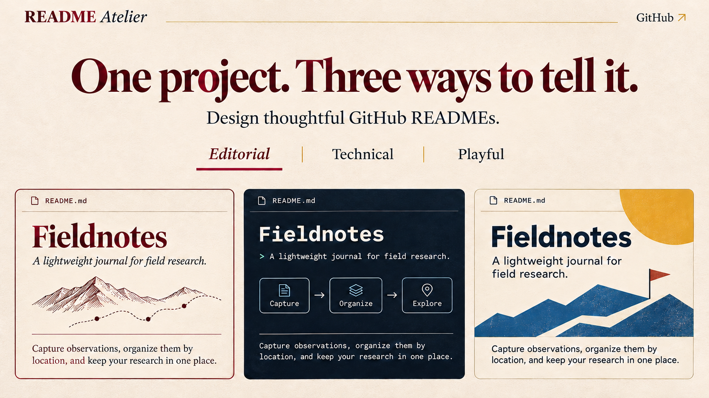
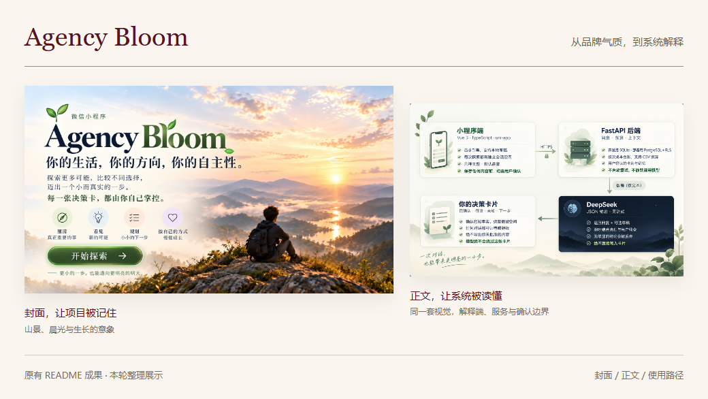
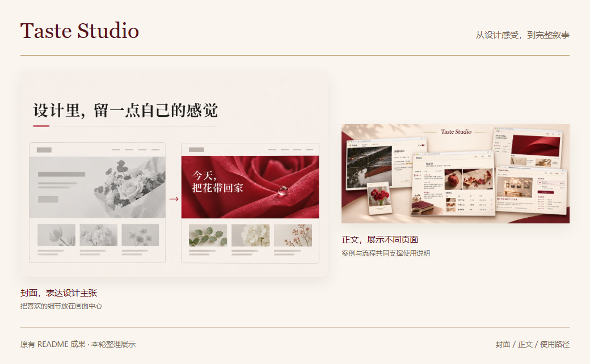
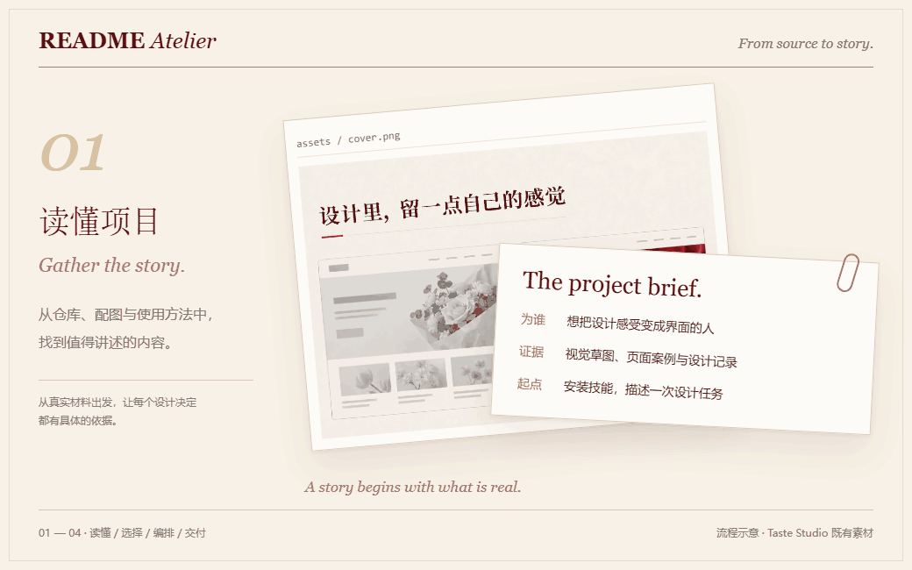
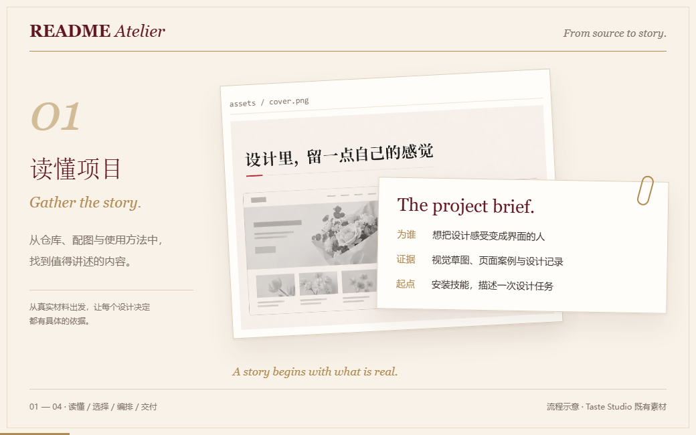

<p align="center">
  <a href="assets/readme/hero.png"></a>
</p>

<p align="center">
  
  
  
</p>

# README Atelier

**一个项目，可以有不同的讲述方式。**

从真实仓库出发，为 README 找到合适的封面、正文配图和阅读顺序。先让人看见项目的价值，再带他走到第一次使用；需要讲清过程时，加入图解与动效。

[看实战案例](#一组看得见的实战案例) · [安装使用](#安装使用) · [看工作流程](#从项目到一份可用的-readme) · [选择交付范围](#这次你想做到哪一步) · [渲染与检查](#好看也能继续修改)

<sub>封面中的 Fieldnotes 是概念示例，用于比较视觉表达；下面展示的是实际项目的改版成果。设计方向由目标项目决定，不限于封面中的三种风格。</sub>

## 一组看得见的实战案例

两个项目，两种表达。Agency Bloom 用山景、晨光和生长意象建立身份；Taste Studio 用花瓣、红纱和编辑式排版表达设计感受。封面之后，正文也继续讲同一个项目。

### Agency Bloom · 从品牌气质，到系统解释

封面讲「你的生活，你的方向，你的自主性」，正文接着用同一套植物与山景语言解释小程序、后端、模型和决策卡之间的关系。先让人理解项目，再交代系统如何工作与怎样开始。

<a href="docs/cases/agency-bloom.md"><picture>
  <source media="(max-width: 600px)" srcset="assets/readme/cases/agency-bloom-mobile.png">
  
</picture></a>

**值得借鉴：** 品牌表达与技术说明有各自的任务，视觉又能相互呼应。图解帮助理解关系，安装命令保留为可复制文字。

[看完整配图与案例说明 →](docs/cases/agency-bloom.md) · [阅读项目 README ↗](https://github.com/Annabelle0726/Agency-Bloom/blob/main/README_zh.md)

### Taste Studio · 从设计感受，到完整叙事

从「设计里，留一点自己的感觉」开始，依次展示设计流程、四种页面案例与具体偏好，再带读者进入安装和使用。图片展示气质，动效解释选择如何发生，文字说明工具能做什么。

<a href="docs/cases/taste-studio.md"><picture>
  <source media="(max-width: 600px)" srcset="assets/readme/cases/taste-studio-mobile.png">
  
</picture></a>

**值得借鉴：** 全页既有统一气质，也有阅读节奏；重要图片直接展示，补充动效与细节按需展开。

[看正文、流程与案例说明 →](docs/cases/taste-studio.md) · [阅读项目 README ↗](https://github.com/Annabelle0726/taste-studio/blob/master/README.md)

<sub>这里展示两个项目已有的 README 设计与配图，本轮重新编排案例展示。原有成果不归为本次技能运行生成；概念配图、流程示意与真实界面的区别见案例说明。</sub>

## 安装使用

需要 **Node.js 22.20+**、npm / npx，以及支持本地 Skills 的编程工具。在终端运行：

```bash
npx skills add Annabelle0726/Readme-Atelier --skill readme-atelier -g
```

按照提示选择你使用的工具。`-g` 安装到本机，供多个项目使用；省略它则安装到当前项目。无需安装一个同名 npm 应用。

然后打开目标项目，开始一次设计：

```text
使用 $readme-atelier 改善这个仓库的 README。
先阅读真实项目，给我 2–3 个不同的视觉方向，等我选择后继续。
封面和正文一起设计：展示真实实例，需要时加入流程图与有意义的动效。
保留能复制的安装命令、使用示例和可编辑源文件。
```

已有明确的视觉方向时，可以直接要求沿用。只想整理旧版，也可以说明要保留哪些图片、内容或语言。

<details>
<summary>检查安装、从本地源码安装与更新</summary>

```bash
npx skills list -g
```

列表中应出现 `readme-atelier`。若没有立即识别，开启新会话或重新加载技能目录。

在本仓库根目录安装当前源码：

```bash
npx skills add . --skill readme-atelier -g
```

更多安装方式和更新命令见[完整安装指南](docs/installation.md)。Python 3.11+ 用于附带的检查脚本；渲染图片与 GIF 的可选依赖单独说明。

</details>

## 从项目到一份可用的 README

<picture>
  <source media="(max-width: 600px)" srcset="assets/readme/workflow-mobile.gif">
  
</picture>

1. **读懂项目。** 找出受众、真实能力、最有说服力的材料与第一次使用路径。
2. **比较方向。** 用可见草图比较构图与表达；由你选择，已有方向就继续打磨。
3. **制作正文。** 将风格延续到实例、图解与演示，关键事实和命令保留为文字。
4. **检查交付。** 实际预览桌面与手机，检查交互、图片、链接与素材来源。

这是以 Taste Studio 既有素材为例、依据技能流程编排的讲解动画，非实际操作录屏。GitHub 中的 GIF 用于播放；[静态流程图](assets/readme/workflow.png)和[手机静态图](assets/readme/workflow-mobile.png)随时可看。

本地打开[交互播放器](assets/readme/source/workflow.html)可暂停、重播与逐段查看。动画来自[可编辑场景](assets/readme/source/workflow.html)，按精确时间渲染；复现方式见[素材与渲染说明](docs/visuals.md)。

<details>
<summary>查看静态流程画面</summary>

<picture>
  <source media="(max-width: 600px)" srcset="assets/readme/workflow-mobile.png">
  
</picture>

</details>

## 这次，你想做到哪一步？

<details open>
<summary><strong>完整改版 · 从项目分析到图文正文</strong></summary>

交付 README、需要的视觉素材、可编辑源文件与验证说明。真实截图用于展示成果，图解用于解释关系，动效用于讲清变化。

```text
使用 $readme-atelier 完整改版这个项目的 README。
面向第一次接触项目的人，先展示真实结果，再说明怎么开始。
保留有价值的图片与内容，让整页有清楚的阅读节奏。
```

</details>

<details>
<summary><strong>只做素材 · 为一段内容找到合适的画面</strong></summary>

制作指定的封面、流程图、截图组合或演示，并提供独立嵌入代码；不改动 README 正文。

```text
使用 $readme-atelier 为这个项目制作工作流程图。
沿用现有视觉，展示真实步骤与产物，提供手机版和可编辑源码。
只交付素材，不修改正文。
```

</details>

<details>
<summary><strong>只做审阅 · 找到读者卡住的地方</strong></summary>

检查阅读顺序、内容依据、图片作用与首次使用路径，给出具体建议。

```text
使用 $readme-atelier 审阅 README。
哪些内容让人难以理解项目，哪些步骤让人无法开始？
只给建议，不修改文件。
```

</details>

## 好看，也能继续修改

正文用 Markdown 保存，图片与动效保留来源，场景通过同一个时间函数重新渲染。改内容时，可以更新素材，继续使用原有的视觉体系。

```text
README.md              可阅读、可搜索、可复制的正文
assets/readme/         封面、实例、流程图、GIF 与静态备用图
assets/readme/source/  可编辑场景与图文排版源文件
docs/                  安装方式、案例说明与渲染方法
```

随 skill 提供的三个工具各有分工：

| 工具 | 用途 |
| --- | --- |
| `audit_readme.py` | 只读检查常见本地链接、图片、大小写和素材体积 |
| `render_scene.mjs` | 将可编辑场景渲染成静态 PNG 或精确时间的序列帧 |
| `assemble_gif.py` | 合成 GIF，保留时长并报告实际尺寸与体积 |

渲染器需要可选的 Playwright 环境，GIF 合成需要 Pillow。技能本身不附带生图模型、浏览器或独立应用；图像生成、录屏与真实项目运行依赖当前工作环境。[安装与渲染命令 →](docs/installation.md#可选渲染流程图与动效)

<details>
<summary>运行本地检查与维护测试</summary>

在本仓库根目录运行：

```bash
python skills/readme-atelier/scripts/audit_readme.py README.md --repo-root .
python -m unittest discover -s tests -v
```

检查其他项目时，替换 README 路径和 `--repo-root`。`--strict` 会把警告也视为失败。检查脚本不会联网验证外部链接，也不能替代实际视觉预览、命令执行和动效检查。

工作流程和能力边界见[技能指引](skills/readme-atelier/SKILL.md)，可选渲染器的集成检查见[安装指南](docs/installation.md)。

</details>

## 参与改进与许可

欢迎通过 [Issue](https://github.com/Annabelle0726/Readme-Atelier/issues) 提供具体场景、预期与实际结果，或提交 Pull Request。

技能采用 [MIT 许可证](LICENSE)。案例中的项目、界面、品牌和个人作品素材保留各自权属，不因被展示而改用本仓库的许可证。[素材来源与视觉说明 →](docs/visuals.md)
