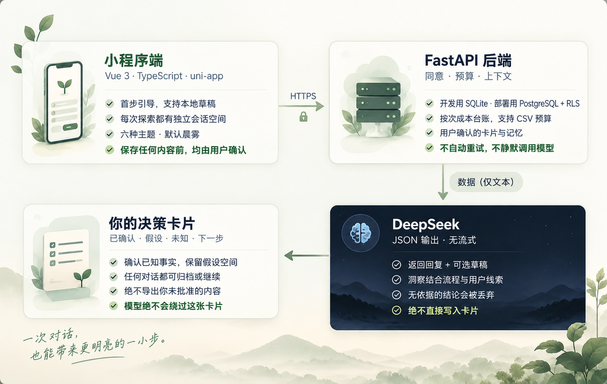

# Agency Bloom：从品牌气质，到系统解释

[返回 README](../../README.md#一组看得见的实战案例) · [项目仓库](https://github.com/Annabelle0726/Agency-Bloom)

这是项目已有的 README 成果展示。本轮选取原有配图、整理案例说明与桌面 / 手机展示图，没有将原有成果归功于本次技能运行。

## 封面如何建立身份

## 正文如何继续解释

品牌封面和系统图均为原有说明性设计素材，不是小程序运行截图。系统图描述小程序、后端、模型与决策卡的关系；具体能力与最新实现以项目文档为准。项目采用 Source-Available 条款，不能当作 MIT 素材使用。

## 本例可借鉴的安排

- 用项目自身的视觉建立第一印象，让读者记住它。
- 在正文继续展示有意义的图：讲清关系或展示结果。
- 将使用方法保留为正文和代码块，补充内容按需展开。

## 来源与边界

封面与正文图来自该项目的 `assets/readme/`。本轮新增的是[案例排版源文件](../../assets/readme/source/agency-bloom-case.html)及其导出图，未重新运行该项目或验证其全部产品能力。图片属于项目原有素材，并非未经处理的产品截图；原始权属与许可保留，不随本仓库改为 MIT。
