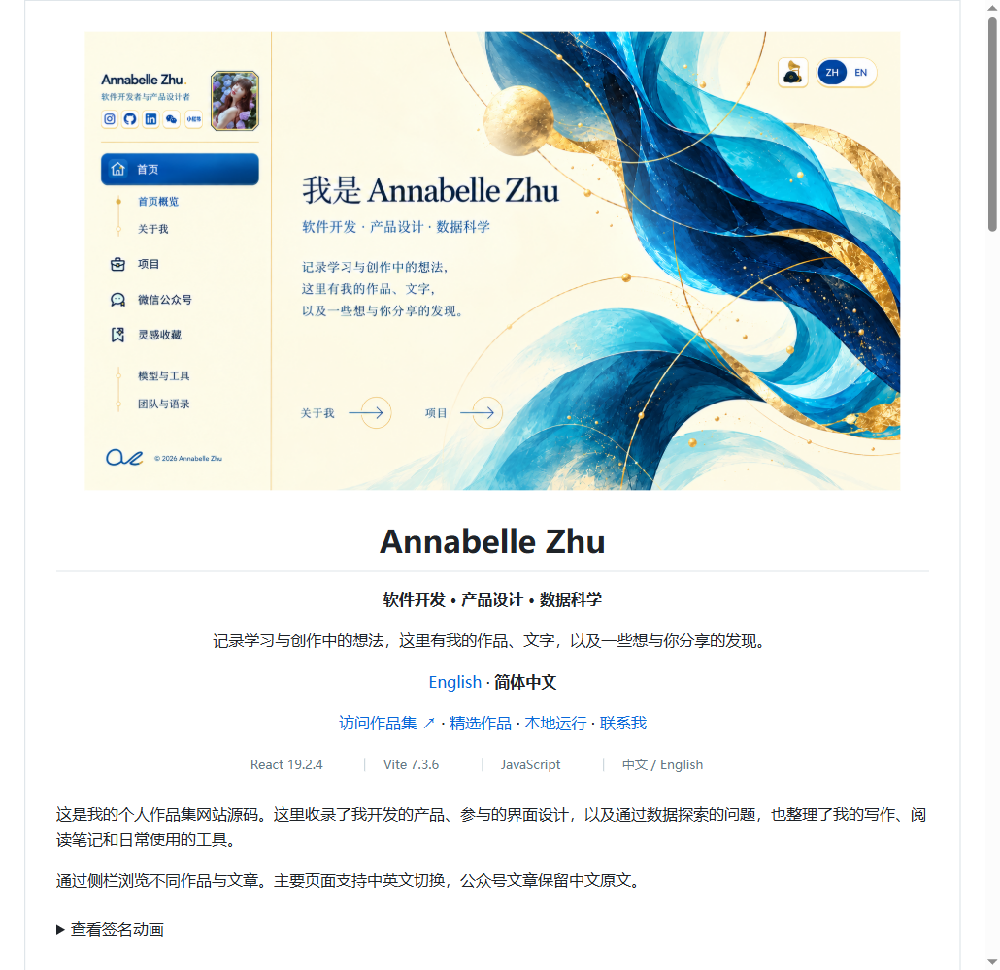
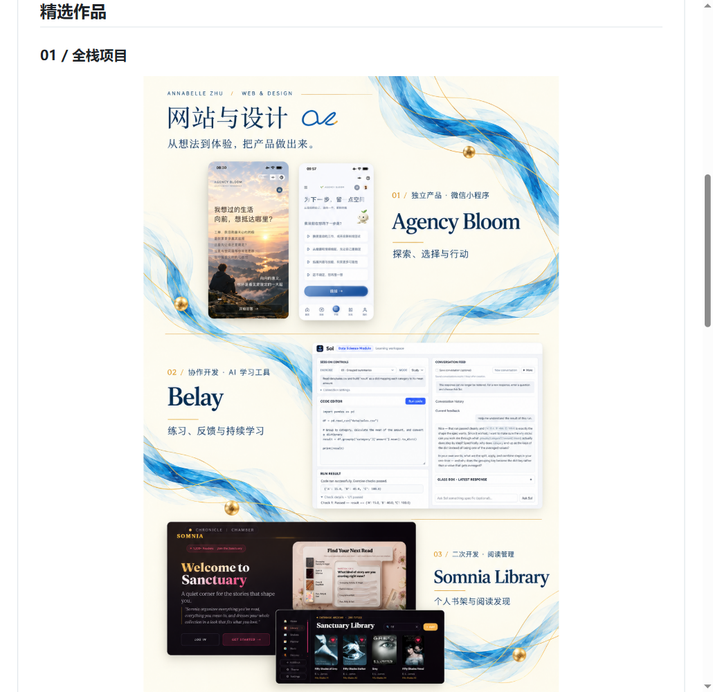

# Annabelle 作品集：留住图，理顺页

[返回 README](../../README.md#一组看得见的实战案例) · [项目仓库](https://github.com/Annabelle0726/Annabelle-portfolio)

这是对现有作品集 README 的实际整理。原稿已有丰富的蓝金视觉和作品展示图；本次任务是降低排布密度，同时保留图片与个人特色。项目本身的功能、个人经历和参与范围没有重新编造。

## 设计取舍

- 从现有素材中选定「我是 Annabelle Zhu」静态首页图作为主封面，避免连续出现两张主封面。
- 直接展示全栈项目、UX/UI 与小幅联系插画，统一展示宽度与两侧留白。
- 数据与 AI、写作与灵感保留项目说明和链接，减少重复的大幅装饰图。
- 原有签名动画与新增页面导览按需展开；本地运行入口保留，局域网访问、构建发布与仓库结构集中收纳。
- 同步更新中文和英文 README。

## 实际首屏

以下是改版后的 Markdown 渲染截图，不是生成的界面。截图是本地 GitHub 风格近似预览，线上排版可能略有差异。

## 实际正文节选

保留下来的全栈作品图直接出现在正文中，项目文字与角色说明继续列在图后。图片作为展示素材，不代替可搜索的文字。

## 来源与验证

原有封面、作品图与联系插画来自目标仓库的 `assets/readme/`。这次使用 README Atelier 整理阅读顺序、展示尺寸与展开内容，并补充实际运行网站截图编排的导览。没有声称原有图片由本技能制作。

本地链接与图片检查无错误，桌面和 390px 手机预览无横向溢出，作品集构建通过。原有签名 GIF 保留体积提醒。此案例记录本地已完成的修改，目标仓库的远程 README 尚未同步此次版本。

案例排版源文件：[portfolio-case.html](../../assets/readme/source/portfolio-case.html)。目标项目与其第三方展示素材保留原有权属，不因被纳入案例而改用本仓库的 MIT 许可。
