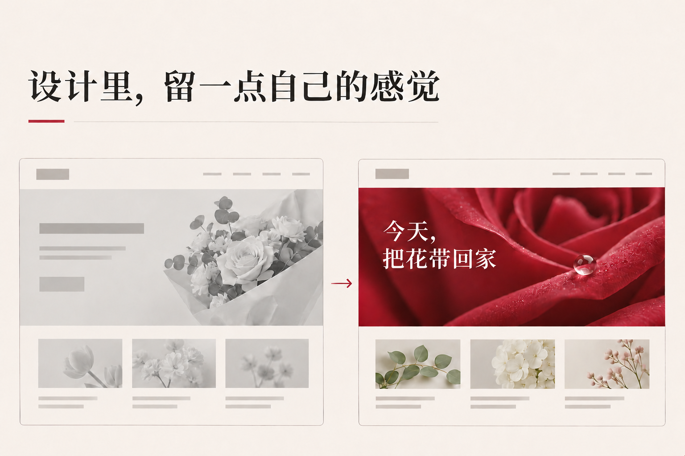
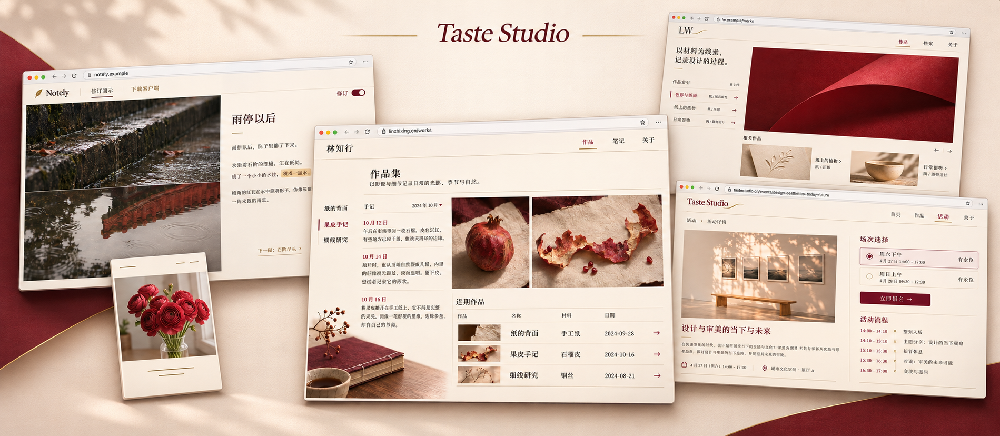

# Taste Studio：从设计感受，到完整叙事

[返回 README](../../README.md#一组看得见的实战案例) · [项目仓库](https://github.com/Annabelle0726/taste-studio)

这是项目已有的 README 成果展示。本轮选取原有配图、整理案例说明与桌面 / 手机展示图，没有将原有成果归功于本次技能运行。

## 封面如何建立身份

## 正文如何继续解释

封面是原有设计概念图；四种页面图是设计预览，不能由此推断所有页面都已实现。原 README 中另有流程示意 GIF 与页面切换演示，分别承担解释与演示的作用。本轮没有修改 Taste Studio README。

## 本例可借鉴的安排

- 用项目自身的视觉建立第一印象，让读者记住它。
- 在正文继续展示有意义的图：讲清关系或展示结果。
- 将使用方法保留为正文和代码块，补充内容按需展开。

## 来源与边界

封面与正文图来自该项目的 `assets/readme/`。本轮新增的是[案例排版源文件](../../assets/readme/source/taste-studio-case.html)及其导出图，未重新运行该项目或验证其全部产品能力。图片属于项目原有素材，并非未经处理的产品截图；原始权属与许可保留，不随本仓库改为 MIT。
