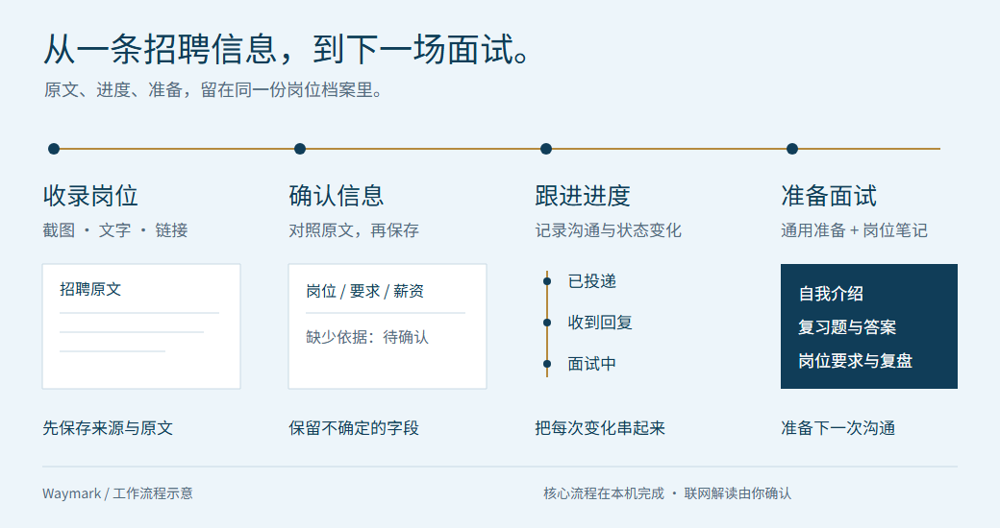
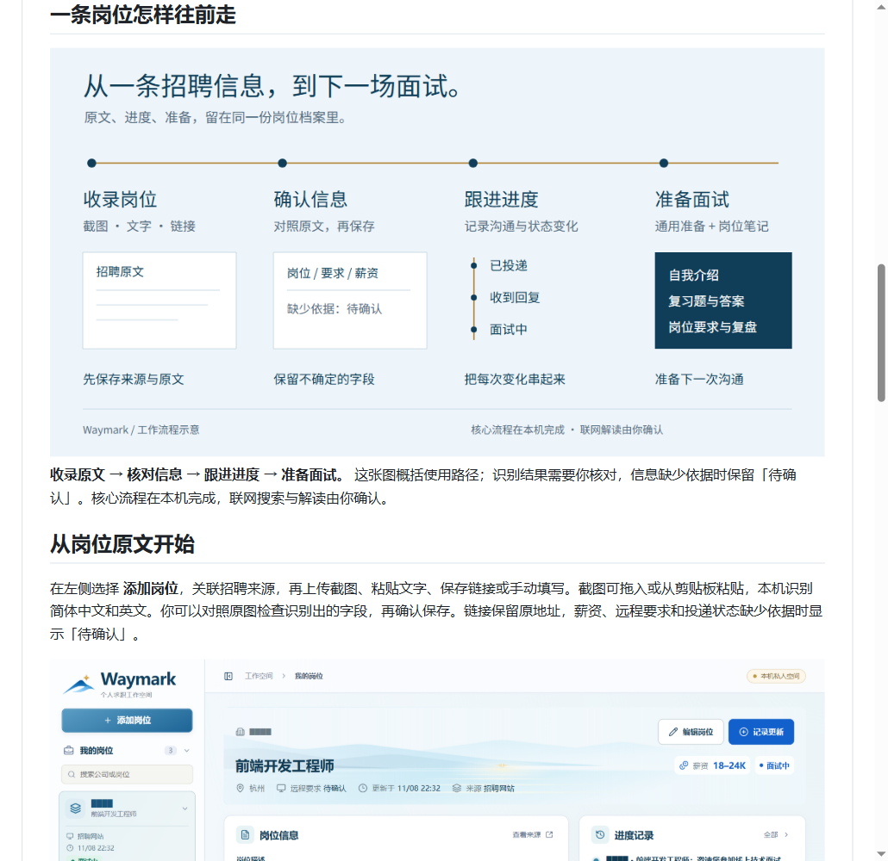

# Waymark：把一条岗位的使用过程讲清楚

[返回 README](../../README.md#一组看得见的实战案例) · [项目仓库](https://github.com/Annabelle0726/Waymark)

Waymark 是本机运行的求职工作空间。原 README 已有实际产品截图、岗位录入演示与完整运行说明。本次更新重点是让第一次来的读者更快找到启动方式，并看懂分散功能之间的关系。

## 这次改了什么

- 将本地启动提前，增加章节导航。
- 新增「收录岗位 → 确认信息 → 跟进进度 → 准备面试」流程图。
- 保留原有真实产品截图与岗位录入演示。
- 将日常维护、可选联网配置等内容整理为可展开的参考；数据去向与能力边界继续保留。

## 新增流程图

<picture>
  <source media="(max-width: 600px)" srcset="../../assets/readme/cases/waymark-workflow-mobile.png">
  
</picture>

这是一张依据现有功能整理的讲解图，不是产品界面。手机采用纵向路径，避免把桌面四列整体缩小。关键步骤也保留为 Markdown 文字。

## 放回 README 中

新增流程图与原有产品截图相接，从整体路径进入具体功能。下面是实际 Markdown 预览节选。

## 来源与验证

原有界面和岗位录入 GIF 沿用目标仓库中的演示素材，使用虚构数据。本轮未重新运行求职应用或操作私人岗位数据；新增内容为图解与文档排布。

本地链接与图片检查无错误，桌面、手机预览和原生折叠已检查，`docker compose config --quiet` 通过。没有将配置检查描述为完整启动验证。此案例记录本地已完成的修改，目标仓库的远程 README 尚未同步此次版本。

案例排版源文件：[waymark-case.html](../../assets/readme/source/waymark-case.html)。目标项目与截图内容保留原有权属，不因被纳入案例而改用本仓库的 MIT 许可。
